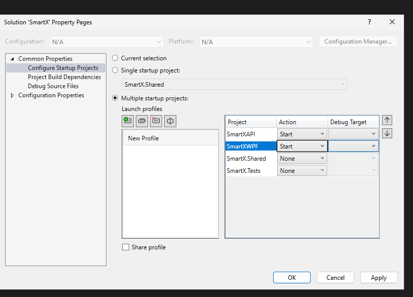

# Smart-X — IoT Ecosystem Gateway

Smart-X is an IoT monitoring and management application developed using C#, .NET 10, ASP.NET Core Web API and WPF.

The application provides sensor registration, telemetry ingestion, historical data queries, device management, alerts, predictive recommendations, secure attachment handling and network topology management.

The network topology component models IoT devices as a weighted, undirected graph. It uses graph traversal, shortest-path routing and Minimum Spanning Tree algorithms to demonstrate how network connectivity and connection costs can be managed.

---

## Table of Contents

1. Project Overview
2. System Architecture
3. Technologies Used
4. Project Structure
5. Data Structures and Algorithms
   - Generic Collections
   - FIFO Telemetry Queues
   - AVL Tree
   - Weighted Graph
   - Breadth-First Search
   - Depth-First Search
   - Dijkstra's Shortest-Path Algorithm
   - Prim's Minimum Spanning Tree
   - Priority Queues, Stacks and Hash Sets
6. Network Topology and Mesh Routing
7. Application Features
8. Installation and Setup
9. Running the Application
10. Using the Application
11. Automated Testing
12. GitHub Actions
13. Project Status

---

## 1. Project Overview


## Youtube video demo
https://youtu.be/Nde7VZvPCMs 

Smart-X provides a centralised environment for monitoring and managing connected IoT devices.

The system supports three sensor categories:

| Sensor category | Data type | Description |
|---|---|---|
| Environmental | `float` | Stores environmental readings. |
| Power Consumption | `int` | Stores power-related readings. |
| Actuator | `bool` | Represents actuator states. |

Telemetry is submitted to the ASP.NET Core API, processed by background services and made available to the WPF application.

The system also includes a simulated mesh network containing a central gateway, registered sensors, relay devices and additional simulated nodes.

### Main objectives

- Ingest and manage sensor telemetry.
- Store and query historical readings.
- Demonstrate generic programming and collection management.
- Implement a self-balancing AVL tree.
- Model network devices and connections using a weighted graph.
- Implement BFS and DFS graph traversal.
- Calculate shortest routes using Dijkstra's algorithm.
- Calculate minimum-cost network connections using Prim's algorithm.
- Simulate device failures and identify unreachable devices.
- Compare the connection cost of the configured network against its minimum spanning tree.

---

## 2. System Architecture

Smart-X uses a layered architecture.

```text
+--------------------------------------+
|             WPF Desktop              |
|                                      |
| Login | Dashboard | Network Topology |
| Sensor Management | Historical Data  |
+------------------+-------------------+
                   |
                   | HTTP / JSON
                   |
+------------------v-------------------+
|          ASP.NET Core API            |
|                                      |
| Sensor Service                       |
| Telemetry Ingestion Service          |
| Telemetry Queue Processor            |
| Mesh Network Service                 |
| Critical Alert Service               |
| Command Service                      |
| Recommendation Service               |
| Attachment Encryption Service        |
+------------------+-------------------+
                   |
                   |
+------------------v-------------------+
|          Shared Data Layer           |
|                                      |
| Models | Generic Collections         |
| AVL Tree | Weighted Graph            |
+--------------------------------------+
```

### Architecture components

**SmartX.Shared**

Contains shared models, generic collections, telemetry structures and the weighted graph implementation. Both the API and desktop application can reference shared types.

**SmartXAPI**

Provides HTTP endpoints and application services. It handles sensor operations, telemetry ingestion, historical queries, network operations, commands, alerts and other application functionality.

**SmartXWPF**

Provides the desktop interface. It communicates with the API through HTTP services and displays sensor information, telemetry, network topology, routes and device status.

**SmartX.Tests**

Contains automated unit tests for the graph algorithms and AVL tree implementation.

---

## 3. Technologies Used

| Technology | Purpose |
|---|---|
| C# | Primary programming language |
| .NET 10 | Application framework |
| ASP.NET Core Web API | Backend API |
| WPF | Desktop user interface |
| XAML | WPF interface layout |
| HTTP / JSON | Communication between frontend and backend |
| Supabase Auth | Authentication |
| AES-GCM | Attachment encryption |
| xUnit | Automated unit testing |
| GitHub Actions | Automated test execution |

---

## 4. Project Structure

```text
SmartX/
│
├── .github/
│   └── workflows/
│       └── unit-tests.yml
│
├── SmartX.Shared/
│   ├── collections/
│   │   ├── SmartCollection.cs
│   │   └── TelemetryAvlTree.cs
│   │
│   ├── Enums/
│   │   └── SensorCategory.cs
│   │
│   ├── Models/
│   │   ├── CommandHistoryEntry.cs
│   │   ├── CommandRequest.cs
│   │   ├── CriticalAlert.cs
│   │   ├── DeploymentNode.cs
│   │   ├── PredictiveRecommendation.cs
│   │   ├── SearchHistoryEntry.cs
│   │   ├── SensorProfile.cs
│   │   └── TelemetryPacket.cs
│   │
│   └── Networking/
│       └── MeshNetWorkGraph.cs
│
├── SmartX.Tests/
│   ├── MeshNetworkGraphTests.cs
│   ├── TelemetryAvlTreeTests.cs
│   └── SmartX.Tests.csproj
│
├── SmartXAPI/
│   ├── DTOs/
│   │   ├── MeshNetworkConnection.cs
│   │   ├── MeshNetworkNode.cs
│   │   └── MeshNetworkTopology.cs
│   │
│   ├── Services/
│   │   ├── AttachmentEncryptionService.cs
│   │   ├── CommandService.cs
│   │   ├── CriticalAlertService.cs
│   │   ├── DeploymentValidationService.cs
│   │   ├── MeshNetworkService.cs
│   │   ├── PredictiveRecommendationService.cs
│   │   ├── SearchHistoryService.cs
│   │   ├── SensorService.cs
│   │   ├── StartupSeeder.cs
│   │   ├── TelemetryIngestionService.cs
│   │   └── TelemetryQueueProcessor.cs
│   │
│   ├── Program.cs
│   ├── appsettings.json
│   └── SmartXAPI.csproj
│
├── SmartXWPF/
│   ├── Dashboard/
│   │   ├── DashboardController.cs
│   │   ├── DashboardState.cs
│   │   ├── DashboardView.cs
│   │   └── TelemetryChartService.cs
│   │
│   ├── DTOs/
│   │   ├── MeshNetworkConnection.cs
│   │   ├── MeshNetworkNode.cs
│   │   ├── MeshNetworkRoute.cs
│   │   └── MeshNetworkTopology.cs
│   │
│   ├── services/
│   │   ├── AlertApiService.cs
│   │   ├── AnomolyDetector.cs
│   │   ├── ApiService.cs
│   │   ├── AttachmentService.cs
│   │   ├── AuthService.cs
│   │   ├── CommandApiService.cs
│   │   ├── MeshNetworkApiService.cs
│   │   ├── MockSeeder.cs
│   │   ├── NetworkTopologyRenderer.cs
│   │   ├── RecommendationApiService.cs
│   │   ├── SearchHistoryApiService.cs
│   │   ├── SensorApiService.cs
│   │   └── TelemetryApiService.cs
│   │
│   ├── NetworkTopologyView.xaml
│   ├── NetworkTopologyView.xaml.cs
│   ├── MainWindow.xaml
│   ├── MainWindow.xaml.cs
│   ├── LoginWindow.xaml
│   ├── LoginWindow.xaml.cs
│   ├── SensorDashboardWindow.xaml
│   ├── SensorDashboardWindow.xaml.cs
│   ├── CommandDashboardWindow.xaml
│   ├── CommandDashboardWindow.xaml.cs
│   └── SmartXWPF.csproj
│
└── README.md
```

---

## 5. Data Structures and Algorithms

### 5.1 Generic Collections

Smart-X uses generic collections to store and manage data without restricting the application to one specific data type.

For example, `TelemetryAvlTree<T>` uses a generic type parameter to support telemetry packets containing different sensor value types.

This allows the same data structure implementation to be reused for environmental, power and actuator telemetry.

Generic collections improve code reuse, maintainability and type safety.

### 5.2 FIFO Telemetry Queues

Telemetry ingestion uses queues to temporarily store incoming sensor readings before they are processed.

A queue follows the First In, First Out (FIFO) principle. The first reading added to the queue is the first reading removed for processing.

The telemetry queue processor periodically checks the queues and processes readings in batches of five. Separate queues are maintained for the different telemetry categories.

This prevents incoming readings from having to be processed immediately when received and provides a controlled ingestion process.

**Time complexity:**

| Operation | Complexity |
|---|---|
| Enqueue | O(1) |
| Dequeue | O(1) |

### 5.3 AVL Tree — Historical Telemetry

**Implementation:** `SmartX.Shared/collections/TelemetryAvlTree.cs`

An AVL tree is a self-balancing Binary Search Tree (BST).

Each node stores a timestamp and a collection of telemetry packets associated with that timestamp.

The tree maintains the ordering property:

- Earlier timestamps are stored in the left subtree.
- Later timestamps are stored in the right subtree.
- Packets with identical timestamps are stored together in the same node.

This allows historical telemetry to be organised chronologically while avoiding the need to scan every stored reading for a date-range query.

#### Why an AVL tree?

A standard unbalanced BST can become inefficient if data is inserted in an already sorted order.

For example, inserting timestamps in chronological order could produce a tree resembling a linked list. Searching and inserting could then degrade from O(log n) to O(n).

An AVL tree prevents this by maintaining a balance factor for each node.

The balance factor is calculated using the heights of its left and right subtrees:

```csharp
private static int GetBalance(Node? node) =>
    node is null
        ? 0
        : GetHeight(node.Left) - GetHeight(node.Right);
```

When an insertion causes the tree to become unbalanced, rotations restore its balance.

The implementation supports four rotation cases:

- Left-Left
- Right-Right
- Left-Right
- Right-Left

These rotations restructure the affected nodes while preserving the chronological ordering of the tree.

For example, a right rotation moves the left child into the parent position and makes the previous parent its right child:

```csharp
private static Node RotateRight(Node pivot)
{
    Node newRoot = pivot.Left!;
    Node? transferredSubtree = newRoot.Right;

    newRoot.Right = pivot;
    pivot.Left = transferredSubtree;

    UpdateHeight(pivot);
    UpdateHeight(newRoot);

    return newRoot;
}
```

After the rotation, the affected node heights are recalculated so that the balance of the tree can be maintained.

#### Insertion

The `Insert()` method adds a telemetry packet and recursively locates the correct timestamp position.

After insertion, the tree updates node heights and checks whether a rotation is required.

```csharp
public void Insert(TelemetryPacket<T> packet)
{
    ArgumentNullException.ThrowIfNull(packet);

    _root = InsertNode(_root, packet);
    Count++;
}
```

The recursive `InsertNode()` method compares the packet timestamp against existing nodes to determine whether it belongs in the left or right subtree.

If a packet has the same timestamp as an existing node, it is added to that node's packet collection instead of creating another node.

This prevents unnecessary duplicate timestamp nodes while preserving all telemetry readings.

#### Historical range queries

The `QueryRange()` method retrieves telemetry between two timestamps.

It can optionally filter results by a device MAC address.

```csharp
public IReadOnlyList<TelemetryPacket<T>> QueryRange(
    DateTime start,
    DateTime end,
    string? deviceMacAddress = null)
```

Rather than visiting every node, the recursive query uses timestamp ordering to skip subtrees that cannot contain matching readings.

For example:

- If a node's timestamp is later than the requested end, its right subtree cannot contain matching timestamps.
- If a node's timestamp is earlier than the requested start, its left subtree cannot contain matching timestamps.

The query also supports case-insensitive MAC address filtering, allowing readings from a specific device to be retrieved without changing the underlying tree structure.

**Efficiency:**

| Operation | Complexity |
|---|---|
| Insert | O(log n) |
| Timestamp lookup | O(log n) |
| Range query | O(log n + k) |
| Storage | O(n) timestamp nodes, plus stored packets |

Here, `n` represents the number of unique timestamp nodes and `k` represents the number of matching telemetry packets returned.

The range-query complexity assumes the tree is balanced and that the traversal can prune irrelevant subtrees. It also excludes the cost of filtering packets stored at matching timestamps.

The AVL tree therefore provides predictable performance as historical telemetry grows.

### 5.4 Weighted Graph — Network Topology

**Implementation:** `SmartX.Shared/Networking/MeshNetWorkGraph.cs`

A graph consists of vertices (nodes) and edges (connections).

Smart-X represents each IoT device as a vertex and each network connection as an edge.

The graph is weighted because each connection has a numerical weight representing its connection cost.

The graph is also undirected: a connection between two devices can be traversed in either direction.

#### Adjacency list representation

The graph uses a nested dictionary to represent its adjacency list:

```csharp
private readonly Dictionary<string, Dictionary<string, double>>
    _adjacencyList =
        new(StringComparer.OrdinalIgnoreCase);
```

Each device maps to its connected neighbours and the weight of each connection.

For example:

```text
Gateway
   |
   +---- Sensor A (5)
   |
   +---- Sensor B (8)

Sensor A
   |
   +---- Sensor B (2)
   |
   +---- Sensor C (6)
```

The graph uses an adjacency list instead of an adjacency matrix.

An adjacency matrix requires O(V²) storage because it maintains a possible connection entry for every pair of vertices, even when relatively few devices are connected.

An adjacency list requires O(V + E) storage because it only stores the devices and their existing connections.

This makes it more suitable for a network where each device connects to selected neighbouring devices rather than every device in the network.

Where:

- V = number of vertices (devices).
- E = number of edges (connections).

#### Adding connections

The `AddConnection()` method registers both devices and stores the connection in both directions.

```csharp
_adjacencyList[deviceA][deviceB] = weight;
_adjacencyList[deviceB][deviceA] = weight;
```

Connection weights are validated to reject negative, infinite and invalid numerical values.

The graph uses a case-insensitive identifier comparer, allowing device identifiers to be resolved regardless of letter casing.

#### Device availability

The graph maintains a separate HashSet containing devices that are currently offline.

```csharp
private readonly HashSet<string> _offlineDevices =
    new(StringComparer.OrdinalIgnoreCase);
```

This allows the application to retain the network's original connections while excluding unavailable devices from traversal, routing and MST calculations.

A device can therefore be marked offline without deleting its connections from the graph. If it becomes available again, it can be returned to the active network.

### 5.5 Breadth-First Search (BFS)

BFS explores a graph level by level, visiting the closest connected devices before moving further away.

The implementation uses a queue to manage devices waiting to be visited.

```csharp
Queue<string> queue = new();
HashSet<string> visited =
    new(StringComparer.OrdinalIgnoreCase);

queue.Enqueue(startDevice);
visited.Add(startDevice);
```

The algorithm repeatedly removes the next device from the queue and examines its neighbours.

Devices are added to the queue only if they have not already been visited and are currently online.

**Example:**

Starting from the gateway:

```text
Gateway
   |
   +---- Sensor A
   |
   +---- Sensor B
           |
           +---- Sensor C
```

BFS explores the gateway first, then its immediate neighbours, followed by the next reachable level.

**Time complexity:** O(V + E)

**Purpose in Smart-X:**

- Determine which devices are reachable from the gateway.
- Identify online devices that have become disconnected.
- Explore the network after a simulated device failure.

### 5.6 Depth-First Search (DFS)

DFS explores one branch of a graph as deeply as possible before returning to explore another branch.

Unlike BFS, which uses a queue, the implementation uses a stack.

```csharp
Stack<string> stack = new();
HashSet<string> visited =
    new(StringComparer.OrdinalIgnoreCase);

stack.Push(startDevice);
```

The algorithm removes the most recently added device from the stack and examines its neighbours.

The visited collection prevents devices from being added repeatedly during exploration.

**Time complexity:** O(V² + E) worst case for this implementation, because it also checks `traversalOrder.Contains()` when processing devices. A conventional DFS using only a visited HashSet would achieve O(V + E).

**Purpose in Smart-X:**

- Explore network branches.
- Demonstrate an alternative graph traversal strategy.
- Compare depth-first and breadth-first exploration.

Both BFS and DFS exclude devices marked as offline.

### 5.7 Dijkstra's Shortest-Path Algorithm

Dijkstra's algorithm calculates the lowest-cost route between a starting device and a destination device in a weighted graph with non-negative edge weights.

Smart-X uses this algorithm to calculate the cheapest route from a selected sensor to the central gateway.

The implementation uses:

- A distance dictionary to track the cheapest known cost to each device.
- A previous-device dictionary to reconstruct the route.
- A priority queue to process the next device with the lowest known distance.

Initially, all distances are set to infinity, except the starting device, which has a distance of zero.

The algorithm examines each neighbour and calculates the cost of reaching it through the current device.

If the new route is cheaper, the distance and previous-device reference are updated.

```csharp
double newDistance =
    distances[currentDevice] + neighbour.Value;

if (newDistance < distances[neighbour.Key])
{
    distances[neighbour.Key] = newDistance;
    previous[neighbour.Key] = currentDevice;

    queue.Enqueue(neighbour.Key, newDistance);
}
```

After reaching the destination, the algorithm follows the previous-device references to reconstruct the route.

The resulting path is reversed so that it runs from the starting device to the destination.

Offline devices are excluded during neighbour evaluation. If the destination cannot be reached, the method returns an empty path and an infinite total weight.

**Time complexity:** Approximately O((V + E) log V) with a priority queue and adjacency-list representation.

**Purpose in Smart-X:**

- Calculate the cheapest route from a sensor to the gateway.
- Compare direct connections against cheaper multi-hop routes.
- Return an empty path when a destination is disconnected or offline.

Dijkstra's algorithm solves a different problem from a Minimum Spanning Tree. It finds the cheapest route between two specific devices, rather than selecting a network-wide set of connections.

### 5.8 Prim's Minimum Spanning Tree (MST)

Prim's algorithm finds a Minimum Spanning Tree for a connected component of a weighted, undirected graph.

A Minimum Spanning Tree connects all vertices in that component while:

- Avoiding cycles.
- Using exactly V - 1 edges.
- Minimising the total connection weight.

Smart-X uses Prim's algorithm to calculate the minimum connection cost required to connect the gateway's reachable network.

The implementation begins at the selected starting device and maintains a set of visited devices.

A priority queue stores candidate connections, prioritised by their weights.

The algorithm repeatedly selects the lowest-weight connection that leads to a device not already included in the tree.

```csharp
PriorityQueue<
    (string From, string To, double Weight),
    double> candidates = new();
```

Once a new device is included, its eligible connections are added to the priority queue.

Connections leading to already visited or offline devices are skipped.

The algorithm finishes when no further eligible connections remain.

**Time complexity:** Approximately O(E log V) for the priority-queue adjacency-list approach.

#### Why use an MST?

A network can contain multiple alternative connections between devices.

Although these connections provide redundancy and alternative routes, they also increase the total connection cost.

An MST identifies a minimum-cost set of connections that keeps the selected connected component connected without introducing cycles.

**Purpose in Smart-X:**

- Calculate a minimum-cost network structure.
- Compare the configured network connection cost with the MST cost.
- Demonstrate how redundant connections affect overall cost.

The implementation starts at the gateway. Consequently, disconnected devices are not included in its MST.

### 5.9 Other Data Structures

Smart-X also uses several additional data structures throughout the application.

| Data structure | Purpose |
|---|---|
| `Dictionary<TKey,TValue>` | Stores device information, distances and lookup data. |
| `HashSet<T>` | Tracks visited devices and offline devices without duplicates. |
| `Queue<T>` | Processes telemetry and BFS traversal in FIFO order. |
| `Stack<T>` | Supports DFS traversal and command history operations. |
| `PriorityQueue<TElement,TPriority>` | Processes the lowest-cost graph connections and routes first. |
| `List<T>` | Stores collections of telemetry packets, nodes, connections and results. |
| Arrays | Store fixed collections of simulated devices. |
| `SortedDictionary<TKey,TValue>` | Maintains timestamp-ordered data. |

The application also demonstrates generic methods, operator overloading, recursive operations and custom collection implementations.

### 5.10 Performance and Scalability Analysis

The selected data structures allow Smart-X to manage increasing amounts of telemetry data and network devices without relying on inefficient linear searches or unnecessary storage.

**Telemetry scalability**

As the number of telemetry readings increases, the AVL tree maintains logarithmic insertion performance by automatically balancing itself.

For example, inserting 1,000 unique timestamp nodes into a balanced AVL tree requires approximately logarithmic search and insertion work rather than potentially examining all 1,000 nodes.

Historical range queries also benefit from timestamp ordering. Instead of examining every stored record, the tree can skip entire subtrees that fall outside the requested date range.

This becomes increasingly useful as historical telemetry accumulates over time.

**Network scalability**

The adjacency list stores only existing network connections.

For example, a network containing 100 devices does not require a 100 × 100 adjacency matrix to represent its connections. The adjacency list stores the 100 device entries and their actual neighbouring connections.

As devices and connections increase:

- BFS and DFS examine the reachable vertices and edges.
- Dijkstra processes candidate routes using a priority queue.
- Prim's algorithm evaluates candidate connections to construct a minimum spanning tree.
- The graph's storage increases proportionally to the number of devices and connections.

**Complexity comparison**

| Structure / Algorithm | Time or Space Complexity | Scalability benefit |
|---|---|---|
| AVL Tree insertion | O(log n) | Maintains efficient insertion as telemetry grows. |
| AVL Tree range query | O(log n + k) | Avoids scanning unrelated timestamp ranges. |
| Adjacency list storage | O(V + E) | Stores only existing network connections. |
| BFS | O(V + E) | Traverses reachable network devices and connections. |
| DFS | O(V² + E) worst case in this implementation | Explores network branches, with an additional visited-order check. |
| Dijkstra | O((V + E) log V) | Finds efficient routes through weighted connections. |
| Prim's MST | O(E log V) | Constructs a minimum-cost connected structure. |

The complexities demonstrate why these structures are appropriate for Smart-X. The AVL tree maintains efficient historical telemetry operations, while the graph supports network traversal, routing and connection-cost optimisation as the IoT environment expands.

**Note:** These are algorithmic complexity estimates, not measured benchmark results. Actual execution time also depends on hardware, data distribution and the number of matching records or connections.

## 6. Network Topology and Mesh Routing

The network topology feature is available through the WPF desktop application's **Network Topology & Mesh Routing** view.

The backend constructs a simulated mesh network containing:

- A central gateway (`GATEWAY-01`).
- Registered environmental, power and actuator sensors.
- Simulated relay devices.
- Additional simulated sensor devices.
- A disconnected test device (`TEST-UNREACHABLE-01`).

The network is represented as a weighted, undirected graph. Devices are represented as vertices, while connections between devices are represented as edges. Each edge has a weight representing its connection cost.

### 6.1 Network Service

**Implementation:** `SmartXAPI/Services/MeshNetworkService.cs`

The `MeshNetworkService` is responsible for configuring the simulated network and exposing graph operations to the API.

It creates the graph, registers nodes and connections, and provides methods for:

- Retrieving the topology.
- Calculating the Minimum Spanning Tree (MST).
- Finding shortest routes.
- Running BFS and DFS.
- Updating device availability.
- Retrieving offline devices.
- Identifying unreachable devices.

The service first locates the required registered sensor categories. It then registers the gateway and sensors before adding the simulated relay and sensor devices.

**Example: Registering the gateway and disconnected test device**

```csharp
_graph.AddDevice(GatewayId);

_nodes.Add(new MeshNetworkNode
{
    Id = GatewayId,
    Label = "Central Gateway",
    IsGateway = true
});

const string disconnectedDeviceId = "TEST-UNREACHABLE-01";

_graph.AddDevice(disconnectedDeviceId);

_nodes.Add(new MeshNetworkNode
{
    Id = disconnectedDeviceId,
    Label = "Disconnected Test Node",
    IsGateway = false,
    Category = "Test",
    DeploymentLocation = "Simulation"
});
```

The disconnected test device is deliberately added to the graph without any edges. This allows the application to demonstrate how graph traversal identifies devices that cannot be reached from the gateway.

**Example: Adding weighted connections**

```csharp
private void AddConnection(
    string deviceA,
    string deviceB,
    double weight)
{
    _graph.AddConnection(deviceA, deviceB, weight);

    _connections.Add(new MeshNetworkConnection
    {
        DeviceA = deviceA,
        DeviceB = deviceB,
        Weight = weight
    });
}
```

Each connection is added to the shared graph and stored as a DTO for the API response. The graph manages the bidirectional relationship, while the DTO provides the information required by the WPF application.

### 6.2 Exposing Graph Algorithms Through the API

The service provides methods that delegate graph operations to `MeshNetWorkGraph`.

**Example: Minimum Spanning Tree and shortest-path operations**

```csharp
public List<MeshNetworkConnection> GetMinimumSpanningTree()
{
    var spanningTree = _graph.MinimumSpanningTree(GatewayId);

    return spanningTree.Select(connection =>
        new MeshNetworkConnection
        {
            DeviceA = connection.DeviceA,
            DeviceB = connection.DeviceB,
            Weight = connection.Weight
        }).ToList();
}

public (List<string> Path, double TotalWeight) FindShortestPath(
    string startDevice,
    string destinationDevice)
{
    return _graph.FindShortestPath(
        startDevice,
        destinationDevice);
}
```

The MST operation uses Prim's algorithm, starting from the gateway. The shortest-path operation uses Dijkstra's algorithm to determine the lowest-cost route between two devices.

The service also exposes BFS and DFS operations, allowing the WPF application to request network traversal without directly accessing the graph implementation.

### 6.3 Network Visualisation

**Implementation:**
- `SmartXWPF/NetworkTopologyView.xaml`
- `SmartXWPF/NetworkTopologyView.xaml.cs`
- `SmartXWPF/services/NetworkTopologyRenderer.cs`

The WPF view retrieves the topology through `MeshNetworkApiService` and uses `NetworkTopologyRenderer` to draw the network on a Canvas.

When the view loads, it retrieves the network topology, reachable devices, unreachable devices and minimum spanning tree asynchronously.

**Example: Loading the topology and calculating network costs**

```csharp
MeshNetworkTopology? topology =
    await _meshNetworkApiService.GetTopologyAsync();

if (topology == null)
    return;

_networkNodes = topology.Nodes;
_networkConnections = topology.Connections;

double fullMeshCost = _networkConnections.Sum(
    connection => connection.Weight);

_minimumSpanningTree =
    await _meshNetworkApiService.GetMinimumSpanningTreeAsync();

double mstCost = _minimumSpanningTree.Sum(
    connection => connection.Weight);

LblFullMeshCost.Text = fullMeshCost.ToString("F2");
LblMstCost.Text = mstCost.ToString("F2");
LblCostSaved.Text = (fullMeshCost - mstCost).ToString("F2");
```

The dashboard displays the following information:

**Network summary**

- Total nodes.
- Reachable nodes.
- Offline or unreachable nodes.

**Topology modes**

- **Full Mesh:** Displays the configured network connections.
- **Minimum Spanning Tree:** Displays the connections selected by Prim's algorithm.

**Connection cost comparison**

The dashboard displays:

- Full Mesh Cost.
- MST Cost.
- Cost Saved.

The full mesh cost is calculated by summing the weights of all configured connections. The MST cost is calculated by summing the weights selected for the spanning tree.

The difference represents the connection weight saved by using the MST instead of all configured connections. This is a comparison of the configured network and its gateway-connected spanning tree, rather than a calculation of every possible connection in a complete graph.

### 6.4 Topology Rendering and BFS-Based Layout

**Implementation:** `SmartXWPF/services/NetworkTopologyRenderer.cs`

The renderer converts the topology data into a visual network diagram.

It first creates an adjacency structure from the connections supplied to the renderer. It then performs BFS from the gateway to determine the hop level of each reachable online device.

**Example: Determining device levels**

```csharp
levels[gateway.Id] = 0;
queue.Enqueue(gateway.Id);

while (queue.Count > 0)
{
    string current = queue.Dequeue();

    foreach (string neighbour in adjacency[current])
    {
        MeshNetworkNode? neighbourNode =
            nodes.FirstOrDefault(node =>
                node.Id.Equals(
                    neighbour,
                    StringComparison.OrdinalIgnoreCase));

        if (neighbourNode == null || !neighbourNode.IsOnline)
            continue;

        if (levels.ContainsKey(neighbour))
            continue;

        levels[neighbour] = levels[current] + 1;
        queue.Enqueue(neighbour);
    }
}
```

The gateway is assigned level zero. Each reachable device is assigned a level based on the number of connections from the gateway along the BFS traversal tree.

The renderer uses these levels to position devices vertically on the Canvas. Devices at the same hop level are distributed horizontally.

This creates a layered network diagram that makes the gateway's relationship with the surrounding devices easier to understand.

Connections are drawn before the nodes so that the lines appear behind the device representations. Each connection also displays its weight.

The renderer uses different visual styles to distinguish:

- The central gateway.
- Relay devices.
- Normal sensors.
- Offline devices.
- Online but unreachable devices.

### 6.5 Network Traversal

Users can select a starting device and choose BFS or DFS to explore the network.

The WPF application determines which traversal algorithm was selected and requests the corresponding result from the API.

**Example: Selecting the traversal algorithm**

```csharp
bool useBfs = selectedAlgorithm.Content.ToString()!
    .StartsWith("Breadth", StringComparison.OrdinalIgnoreCase);

List<string> visitedDevices;

if (useBfs)
{
    visitedDevices =
        await _meshNetworkApiService.GetReachableDevicesAsync(
            startNode.Id);
}
else
{
    visitedDevices =
        await _meshNetworkApiService.GetDepthFirstTraversalAsync(
            startNode.Id);
}
```

The resulting device order is displayed in the dashboard, allowing users to compare level-by-level exploration with depth-first exploration.

### 6.6 Sensor Routing

Users can select a sensor and calculate its shortest route to the gateway using Dijkstra's algorithm.

The gateway, relay devices and disconnected test devices are excluded from the sensor selection list.

**Example: Calculating a route to the gateway**

```csharp
MeshNetworkRoute? route =
    await _meshNetworkApiService.GetShortestRouteAsync(
        device.Id,
        "GATEWAY-01");

if (route == null || route.Path.Count == 0)
{
    LblRouteResult.Text =
        "No route to the gateway could be found.";
    return;
}

string routePath = string.Join(" → ", route.Path);

LblRouteResult.Text =
    $"Starting device: {device.Id}\n" +
    $"Shortest route: {routePath}\n" +
    $"Total route weight: {route.TotalWeight:0.##}";
```

The result displays the selected sensor, the calculated route and its total weight. If no valid route exists, the dashboard informs the user that the gateway cannot be reached.

### 6.7 Device Management

Users can take a device offline or bring it online through the device management controls.

When the user changes a device's availability, the WPF application sends the update through `MeshNetworkApiService` and reloads the topology to retrieve the updated network state.

At the backend, `MeshNetworkService` updates both the graph and the corresponding API node:

```csharp
_graph.SetDeviceOnline(deviceId, isOnline);

MeshNetworkNode? node = _nodes.FirstOrDefault(
    n => n.Id.Equals(
        deviceId,
        StringComparison.OrdinalIgnoreCase));

if (node != null)
{
    node.IsOnline = isOnline;
}
```

This keeps the graph's availability information and the node information returned to the frontend consistent.

### 6.8 Offline and Unreachable Devices

Smart-X distinguishes between an offline device and an unreachable device.

An **offline device** has explicitly been marked as unavailable.

An **unreachable device** may still be online, but it cannot be reached from the gateway through the currently available connections.

The graph stores offline device identifiers in a `HashSet<string>`.

When a device is taken offline:

- BFS and DFS exclude it.
- Dijkstra's algorithm cannot route through it.
- Prim's algorithm excludes it from the spanning tree.
- Reachability calculations are updated.

The `GetUnreachableDevices()` method performs BFS from the gateway and identifies online devices that are not included in the resulting reachable set.

The simulated `TEST-UNREACHABLE-01` node demonstrates this behaviour because it is registered in the graph without any connections.

The WPF renderer also independently calculates BFS levels for visual positioning. It separates explicitly offline devices from online devices that cannot be reached from the gateway and places both groups in a dedicated area of the diagram.

This allows the dashboard to communicate network failures visually, rather than relying only on text-based status information.

### 6.9 Performance and Scalability Considerations

The topology feature uses graph algorithms selected for different network operations:

| Operation | Algorithm | Time Complexity |
|---|---|---|
| Network traversal | BFS | O(V + E) |
| Network traversal | DFS | O(V² + E) in the current implementation |
| Shortest route | Dijkstra with priority queue | O((V + E) log V) |
| Minimum spanning tree | Prim with priority queue | O(E log V) |

Where:

- `V` represents the number of devices (vertices).
- `E` represents the number of connections (edges).

BFS and DFS allow the application to explore connected devices without repeatedly examining every possible pair of devices. Dijkstra's algorithm provides weighted shortest routes, while Prim's algorithm identifies a minimum-weight spanning tree for the gateway-connected component.

The graph uses an adjacency-list representation, allowing traversal to focus on existing connections rather than scanning a full vertex-to-vertex matrix.

The renderer also uses BFS to arrange reachable devices into hop levels. This makes the topology easier to interpret as the number of connected devices increases.

The current implementation is a simulated mesh network intended to demonstrate routing, traversal, availability and network-cost analysis. Its complexity characteristics describe the algorithms, rather than measured production performance. The WPF renderer also performs additional node lookups while calculating its layout, so its rendering cost includes work beyond the underlying BFS traversal.

## 7. Application Features

### Authentication

The WPF application uses Supabase authentication to provide login functionality.

### Sensor Management

Users can manage registered sensors and view their category, device identifier and deployment information.

### Telemetry Ingestion

The API accepts telemetry for environmental, power and actuator sensors.

Incoming readings are validated and placed into their respective processing queues.

### Historical Telemetry

Historical readings can be queried using a date range and a registered sensor's MAC address.

The AVL tree provides timestamp-based storage and range-query functionality.

### Critical Alerts

The alert service uses priority-based processing and a hash set to support alert management and prevent duplicate entries.

### Commands

The command service manages device commands and simulated device states.

Command history is maintained to support reviewing and undoing previous actions.

### Predictive Recommendations

The recommendation service generates predictive recommendations based on available application data.

### Search History

Search history is maintained to allow previous searches to be retrieved.

### Secure Attachments

The attachment encryption service uses AES-GCM encryption to protect attachment data.

### Dashboard

The main dashboard provides a central view of application activity, sensor information and telemetry.

### Network Topology and Mesh Routing

The network management dashboard provides topology visualisation, traversal, shortest-path routing, MST cost comparison and device failure simulation.

---

## 8. Installation and Setup

### Prerequisites

Ensure the following are installed:

- Windows 10 or later.
- Visual Studio 2022 or a compatible .NET development environment.
- .NET 10 SDK.
- Git.
- Internet access for authentication and required external services.

The WPF desktop application requires Windows.

### Clone the repository

```bash
git clone <repository-url>
```

Navigate into the project directory:

```bash
cd SmartX
```

### Restore dependencies

```bash
dotnet restore
```

### Configure application settings

Before running the application, configure the required application settings.

**API configuration**

The API uses an `appsettings.json` file to store its configuration. This file is excluded from source control to prevent sensitive configuration values from being committed to GitHub.

After cloning the repository:

1. Navigate to the `SmartXAPI` folder.
2. Create a new file named `appsettings.json`.

**Generate the AES-256 Encryption Key**

Smart-X uses AES-256-GCM to encrypt attachment files. The API requires a cryptographically secure, randomly generated 256-bit encryption key encoded in Base64.

To generate a valid key on Windows:

1. Open PowerShell.
2. Run the following command:

```powershell
$key = [byte[]]::new(32)
$rng = [System.Security.Cryptography.RandomNumberGenerator]::Create()
$rng.GetBytes($key)
[Convert]::ToBase64String($key)
$rng.Dispose()
```

3. Copy the generated Base64 string. This is your encryption key.

**Configure appsettings.json**

Add the following configuration to `SmartXAPI/appsettings.json`:

```json
{
  "Logging": {
    "LogLevel": {
      "Default": "Information",
      "Microsoft.AspNetCore": "Warning"
    }
  },
  "AllowedHosts": "*",
  "AttachmentEncryptionKey": "PASTE_GENERATED_KEY_HERE"
}
```

Replace `PASTE_GENERATED_KEY_HERE` with the Base64 key generated in PowerShell.

The `AttachmentEncryptionKey` setting is used by the API's AES-GCM encryption service to encrypt and decrypt attachment data.

**Important:**
- Generate your own key; do not reuse an example key.
- Keep the key private and never commit it to GitHub.
- Keep the same key between application restarts. Existing encrypted attachments cannot be decrypted using a newly generated key.
- If the key is lost or changed, previously encrypted attachments may become inaccessible.

## Running Smart-X

### Prerequisites
- Visual Studio 2022 or later.
- .NET 10 SDK.
- A valid application configuration file (`appsettings.json`).
- The required API configuration and security key.

### Startup Configuration

Smart-X consists of two applications that must run together:

| Project | Startup action |
|---|---|
| SmartXAPI | Start |
| SmartXWPF | Start |
| SmartX.Shared | None |
| SmartX.Tests | None |




### Configure Multiple Startup Projects

1. Open `SmartX.sln` in Visual Studio.
2. Right-click the solution in Solution Explorer and select **Properties**.
3. Navigate to **Startup Project**.
4. Select **Multiple startup projects**.
5. Configure the projects according to the table above.
6. Click **Apply**, then **OK**.

### Running the Application

1. Ensure the API configuration file and required security key have been configured.
2. Start the solution using the green Run button in Visual Studio.
3. Visual Studio will launch both the ASP.NET Core API and the WPF desktop application.
4. The WPF application communicates with the API through the configured local API address.

**Note:** `SmartX.Shared` is a shared class library and `SmartX.Tests` is a test project. Neither needs to be launched as an application.

**WPF configuration**

The WPF application reads its API address through the `ApiBaseUrl` application setting.

Ensure that this setting points to the address where the ASP.NET Core API is running.

**Supabase authentication**

Configure the Supabase project URL and publishable key required by the authentication service.

Do not commit private credentials, service-role keys or production encryption secrets to source control.

### Build the solution

From the project root:

```bash
dotnet build
```

---

## 9. Running the Application

The API must be running before launching the WPF application.

### Start the API

From the project root:

```bash
dotnet run --project SmartXAPI/SmartXAPI.csproj
```

The API will start using its configured launch settings.

Keep the API running while using the desktop application.

### Start the WPF application

Open a second terminal from the project root:

```bash
dotnet run --project SmartXWPF/SmartXWPF.csproj
```

Alternatively, open the project in Visual Studio and run the WPF startup project.

### Running both projects in Visual Studio

1. Open the Smart-X solution.
2. Set the API and WPF projects as multiple startup projects.
3. Configure both projects to start.
4. Run the solution.

---

## 10. Using the Application

### Step 1 — Sign in

Launch the WPF application and authenticate using the configured Supabase account.

### Step 2 — Open the dashboard

After authentication, access the main dashboard to view application information and available management features.

### Step 3 — Manage sensors

Register or inspect the available sensor profiles.

The demo network requires an environmental, power consumption and actuator sensor to be available before its topology is configured.

### Step 4 — Ingest telemetry

Submit sensor readings through the application's telemetry functionality.

The API validates and queues incoming readings for processing.

### Step 5 — View historical telemetry

Navigate to the Network Topology & Mesh Routing view.

In the Historical Telemetry section:

1. Select a registered sensor.
2. Select a start date.
3. Select an end date.
4. Click **Query Historical Readings**.

The application displays matching readings in the historical telemetry table.

### Step 6 — Inspect network topology

Open the Network Topology & Mesh Routing view.

The dashboard displays the configured devices and their connections.

Select between Full Mesh and Minimum Spanning Tree to compare the network structures.

### Step 7 — Compare connection costs

Review the Full Mesh Cost, MST Cost and Cost Saved metrics.

These values demonstrate the difference between the configured network connections and the minimum spanning tree.

### Step 8 — Run network traversal

In the Network Traversal section:

1. Select a starting device.
2. Select BFS or DFS.
3. Click **Run Network Traversal**.

The resulting traversal order is displayed.

### Step 9 — Calculate a shortest route

In the Sensor Routing section:

1. Select a sensor.
2. Click **Find Route to Gateway**.

The application displays the calculated route and its total weight.

### Step 10 — Simulate a network failure

In Device Management:

1. Select a device.
2. Click **Take Device Offline**.
3. Observe the updated network summary and failure impact.
4. Run BFS or DFS again to see the effect on traversal.
5. Calculate a route to observe whether the gateway is still reachable.

The device can be restored using **Bring Device Online**.

---

## 11. Automated Testing

**Test project:** `SmartX.Tests`

The project uses xUnit to test the graph and AVL tree implementations.

### Graph tests

The graph test suite covers:

- Bidirectional connection creation.
- BFS traversal.
- DFS traversal.
- Disconnected device handling.
- Minimum Spanning Tree total weight.
- MST edge count.
- MST cycle prevention.
- Independent MST verification using Kruskal's algorithm.
- Dijkstra shortest-path calculations.
- Alternative route selection.
- Unreachable destinations.
- Case-insensitive device identifiers.
- Invalid connection weights.
- Offline-device traversal and routing behaviour.

The MST implementation is independently checked against Kruskal's algorithm.

The shortest-path implementation is independently checked against Bellman-Ford calculations on a larger generated network.

These independent reference algorithms provide additional confidence that the graph implementation returns correct results.

### AVL tree tests

The AVL tree test suite validates timestamp-based insertion, balancing and historical range-query behaviour.

### Run all tests

From the project root:

```bash
dotnet test SmartX.Tests/SmartX.Tests.csproj
```

### Run tests in Release configuration

```bash
dotnet test SmartX.Tests/SmartX.Tests.csproj --configuration Release
```

A successful test run reports the number of passed tests and any failures.

---

## 12. GitHub Actions

Smart-X includes a GitHub Actions workflow:

```text
.github/workflows/unit-tests.yml
```

The workflow automatically runs the unit test project when changes are pushed to the `main` branch.

It performs the following steps:

1. Checks out the repository.
2. Installs the .NET 10 SDK.
3. Restores the test project dependencies.
4. Builds and runs the tests in Release configuration.

The workflow can also be started manually through GitHub Actions using `workflow_dispatch`.

This provides automated verification of the graph and AVL tree functionality whenever changes are pushed to the main branch.

---

## 13. Project Status

| Component | Status |
|---|---|
| WPF desktop application | Implemented |
| ASP.NET Core Web API | Implemented |
| Supabase authentication | Implemented |
| Sensor management | Implemented |
| Telemetry ingestion | Implemented |
| Historical telemetry queries | Implemented |
| Generic telemetry collections | Implemented |
| AVL tree | Implemented |
| Critical alerts | Implemented |
| Device commands and history | Implemented |
| Predictive recommendations | Implemented |
| Search history | Implemented |
| AES-GCM attachment encryption | Implemented |
| Weighted network graph | Implemented |
| Breadth-First Search | Implemented |
| Depth-First Search | Implemented |
| Dijkstra shortest-path routing | Implemented |
| Prim Minimum Spanning Tree | Implemented |
| Network topology visualisation | Implemented |
| Offline-device simulation | Implemented |
| Unreachable-device detection | Implemented |
| MST cost comparison | Implemented |
| Automated unit tests | Implemented |
| GitHub Actions test workflow | Implemented |

---

## Academic Context

Smart-X demonstrates the application of data structures and algorithms in a practical IoT management environment.

The project applies trees, graphs, queues, stacks, dictionaries, hash sets and priority queues to real application operations.

The AVL tree provides efficient timestamp-based telemetry organisation and range queries.

The weighted graph models network devices and their connections. BFS and DFS explore network connectivity, Dijkstra calculates the lowest-cost route between two devices, and Prim's algorithm identifies a minimum-cost connected network structure.

Together, these implementations demonstrate how data structures and algorithms can be applied to improve the efficiency, reliability and maintainability of a software system.
